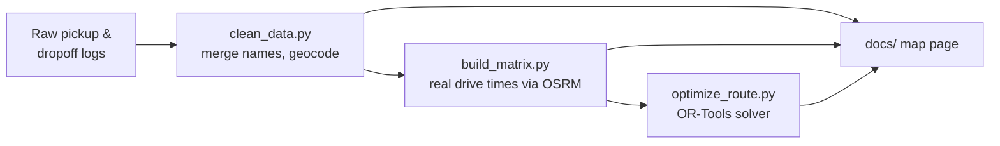

<div align="center">

# 🎾 Bin to Better — Tennis Ball Map

**An interactive map and route planner for Bin to Better's tennis ball recycling network across the Bay Area.**

[](https://cloviewovie123.github.io/b2bmap/)
[](https://bintobetter.org)


</div>

---

## About

[Bin to Better](https://bintobetter.org) collects used tennis balls from tennis clubs and gives them a second life as dog toys at shelters, rescues, and doggy daycares, instead of sending them to a landfill.

This project puts that whole network on one map and answers a practical question: **what's the shortest way to drive the pickup run?**

| | |
|---|---|
| 🎾 **Balls moved** | 48,671 |
| 📍 **Sites mapped** | 32 (9 pickup clubs, 23 dropoff partners) |
| 🗓️ **Visits logged** | 59, from Aug 2025 to Sep 2026 |
| 🚗 **Pickup run** | 79.9 mi → **69.4 mi** with the optimized route (**−13%**, about 11 min saved) |

## Features

- **Interactive map:** every pickup and dropoff site, color-coded, with marker size scaled to total balls collected
- **Site history:** click a marker to see total balls, number of visits, and each visit's date
- **Search, filters, and dark mode:** find a site, filter by time range, switch base maps
- **Route comparison:** the usual "nearest-first" route vs. the optimal route, drawn on real roads
- **Custom route planner:** pick only the sites available that day and compare *your order*, *nearest-first*, and *best*

## How it works



1. **Clean the data.** Merge spelling variants of the same site, total balls per site, keep per-visit history, and remove personal contact info.
2. **Geocode.** Look up coordinates for every site and flag low-confidence matches.
3. **Measure real distances.** Get driving time and distance between every pair of sites from [OSRM](https://project-osrm.org/).
4. **Optimize.** Solve the route as a traveling salesman problem with Google OR-Tools, starting and ending in Fremont.
5. **Plan in the browser.** GitHub Pages can't run Python, so the map solves custom routes in JavaScript (exact Held-Karp up to 15 stops, 2-opt beyond). The results were checked against OR-Tools.

## Project structure

```
b2bmap/
├── docs/                  # The website (served by GitHub Pages)
│   ├── index.html         # Map, filters, and route planner
│   └── data/              # sites.json, routes.json, matrix.json
├── scripts/
│   ├── clean_data.py      # Clean + geocode raw logs
│   ├── build_matrix.py    # Drive time/distance matrix (OSRM)
│   └── optimize_route.py  # Route optimizer (OR-Tools)
└── data/clean/            # Cleaned, geocoded data
```

## Run it locally

```bash
pip install ortools requests

python scripts/clean_data.py       # clean + geocode
python scripts/build_matrix.py     # distance matrix
python scripts/optimize_route.py   # compare routes

cd docs && python -m http.server   # open http://localhost:8000
```

Compare your own stops:

```bash
python scripts/optimize_route.py --stops "Mountain View Tennis,Kim Grant Tennis"
```

## Limitations

- Drive times ignore traffic and the time spent at each stop.
- One driver, one car, no capacity or time-window limits.
- Savings are **projected** from the model and haven't been measured on a real run yet.

## Built with

Python, Google OR-Tools, OSRM, Leaflet, and OpenStreetMap. Code was written with help from [Claude Code](https://claude.com/claude-code).

Map data © [OpenStreetMap](https://www.openstreetmap.org/copyright) contributors.

---

<div align="center">

♻️ A [Bin to Better](https://bintobetter.org) project

</div>
